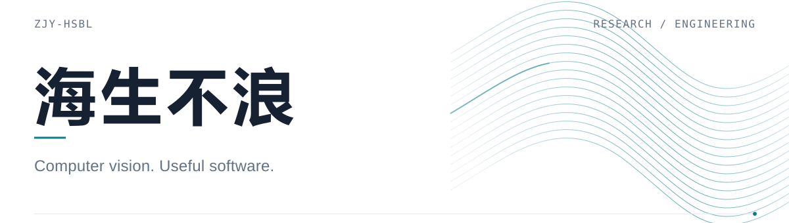

  <picture>
    <source media="(prefers-color-scheme: dark)" srcset="assets/header-dark.svg">
    <source media="(prefers-color-scheme: light)" srcset="assets/header-light.svg">
    
  </picture>

<h1 align="center">�������� �� ZJY-HSBL</h1>

  <b>�������� �� ������Ӿ� �� ��Ч AI</b> 
  Software Engineering �� Computer Vision �� Efficient AI

  <a href="https://zjy-hsbl.github.io/"><b>������վ / Website �J</b></a>
  &nbsp; �� &nbsp;
  <a href="https://www.zhihu.com/people/HSBLZHAOJY"><b>֪�� / Zhihu �J</b></a>
  &nbsp; �� &nbsp;
  <a href="https://github.com/ZJY-HSBL?tab=repositories"><b>����ֿ� / Repositories �J</b></a>

  
  
  

  <a href="#research">�����</a> &nbsp; / &nbsp;
  <a href="#projects">������Ŀ</a> &nbsp; / &nbsp;
  <a href="#publications">��������</a> &nbsp; / &nbsp;
  <a href="#honors">����</a> &nbsp; / &nbsp;
  <a href="#stack">����ջ</a>

---

## About �� ������

��ã�����**��������**����Ҫ��ע**������Ӿ������ѧϰ����������ϵͳ**������ʵ��ɸ������빤��ʵ�֡�ϣ�����о��еķ�����ת��Ϊ�������ɿ������õ�������

I work on **computer vision, deep learning, and intelligent software systems**, with an emphasis on reproducible experiments and practical engineering.

## Research �� �����

- **�Ӿ���֪ / Visual Perception** �� Ŀ���⡢��Ŀ��������������Ӿ�ģ�͡�
- **ҽѧ AI / Medical AI** �� ҽѧӰ��������Լ������ָ����
- **ʱ��ѧϰ / Spatiotemporal Learning** �� ��̬ͼ��ģ�뽻ͨ��Ԥ�⡣

> **���� / Ongoing** �� ��ģ̬ MRI ��������������ָ��о��� 
> Multimodal MRI brain-tumor detection and segmentation.

## Selected Work �� ������Ŀ

### Research & Algorithms �� �������㷨

| ��Ŀ / Project | �о������뷽�� / Focus |
| :--- | :--- |
| **[AMFTrack �J](https://github.com/ZJY-HSBL/AMFTrack)** | **��Ŀ�����** �� ����Ӧ�˶����������������� Multi-object tracking with adaptive motion estimation and feature association. |
| **[DynaFlux �J](https://github.com/ZJY-HSBL/DynaFlux)** | **��ͨ��Ԥ��** �� ��߶ȶ�̬ͼѧϰ�� Multi-scale dynamic graph learning for traffic-flow forecasting. |
| **[ScolioVision �J](https://github.com/ZJY-HSBL/ScolioVision)** | **ҽѧӰ��** �� ��������Ӱ������뿵�������� Research-oriented scoliosis imaging and rehabilitation workflow. |
| **[BoundEvo �J](https://github.com/ZJY-HSBL/BoundEvo)** | **�����Ż�** �� �ɸ��ֵ�����Ӧ�߽��Ż��㷨�� Reproducible adaptive-boundary evolutionary optimization. |

### Software & Tools �� �����빤��

| ��Ŀ / Project | ����ʵ�� / Focus |
| :--- | :--- |
| **[Iterduca �J](https://github.com/ZJY-HSBL/Iterduca)** | **����·��** �� ���� PyQt6 �� Mihomo �� Windows �ͻ��ˡ� Windows desktop network-routing client built with PyQt6 and Mihomo. |
| **[FolderBox �J](https://github.com/ZJY-HSBL/FolderBox)** | **����������** �� �����������ļ��������� Lightweight desktop folder containers and workspace management. |
| **[Vitrunda �J](https://github.com/ZJY-HSBL/Vitrunda)** | **���潻��** �� �������岣������Ч���� Windows ԭ����������ԭ�͡� Experimental native Windows hidden-desktop interface with fluid glass transitions. |

## Selected Publications �� ��������

**Ŀ���� / Object Detection**

- **[SNEIF-YOLO11: A Lightweight Real-Time Framework for Fighting Behavior Detection](https://doi.org/10.1007/s11760-025-04731-2)** 
  *Signal, Image and Video Processing* �� 2025 �� �ڶ����� / Second author
- **[ABCP-YOLO11: An Attention-Enhanced Framework for Intelligent Fracture Detection](https://doi.org/10.1007/s11760-026-05303-8)** 
  *Signal, Image and Video Processing* �� 2026 �� �������� / Fourth author
- **[A Lightweight Face Detection Framework Based on ShuffleNet and Coordinate Attention](https://doi.org/10.1109/GAIIS69281.2026.11519106)** 
  GAIIS 2026 �� ��һ���� / First author

**��Ŀ����� / Multi-Object Tracking**

- **[Efficient Multi-Object Tracking in Traffic Surveillance based on Adaptive FairMot and Low-Confidence Matching](https://doi.org/10.1109/ISPP69262.2026.11542983)** 
  ISPP 2026 �� ��һ���� / First author

## Honors �� ����

- **2025 �� ���Ҷ��Ƚ�** �� ȫ����ѧ����ѧ��ģ�������߽��籭�������顣 
  National Second Prize �� Contemporary Undergraduate Mathematical Contest in Modeling
- **2025 �� �������Ƚ�** �� ��ʮ�߽�ȫ����ѧ����ѧ����������ѧ A �ࣩ�� 
  National Third Prize �� 17th Chinese Mathematics Competitions, Non-Mathematics Category A
- **2026 �� ʡ���Ƚ�** �� ����ʡ�ߵ�ѧУ�ڶ�ʮ����ߵ���ѧ��������һ�� A�� 
  Provincial Second Prize �� 23rd Jiangsu Advanced Mathematics Competition

## Stack �� ����ջ

  <picture>
    <source media="(prefers-color-scheme: dark)" srcset="https://skillicons.dev/icons?i=py,pytorch,opencv,sklearn,qt,flask,java,c,cpp,mysql,linux,git,github,nginx,vscode&amp;perline=8&amp;theme=dark">
    <source media="(prefers-color-scheme: light)" srcset="https://skillicons.dev/icons?i=py,pytorch,opencv,sklearn,qt,flask,java,c,cpp,mysql,linux,git,github,nginx,vscode&amp;perline=8&amp;theme=light">
    
  </picture>

- **AI & Research** �� Python / PyTorch / OpenCV / scikit-learn
- **Software** �� Qt / Flask / Java / C / C++ / MySQL
- **Engineering** �� Linux / Git / GitHub / Nginx / VS Code

## Contributions �� ��̬����

  <a href="https://github.com/ZJY-HSBL?tab=overview">
    <picture>
      <source media="(prefers-color-scheme: dark)" srcset="https://raw.githubusercontent.com/ZJY-HSBL/ZJY-HSBL/output/github-contribution-grid-snake-dark.svg">
      <source media="(prefers-color-scheme: light)" srcset="https://raw.githubusercontent.com/ZJY-HSBL/ZJY-HSBL/output/github-contribution-grid-snake.svg">
      
    </picture>
  </a>

---

  <b>Research �� Engineering �� Reproducibility</b> 
  ���о��뷨�����ɸ��ֵ�ʵ�飬�ٵ����õĹ��ߡ�

